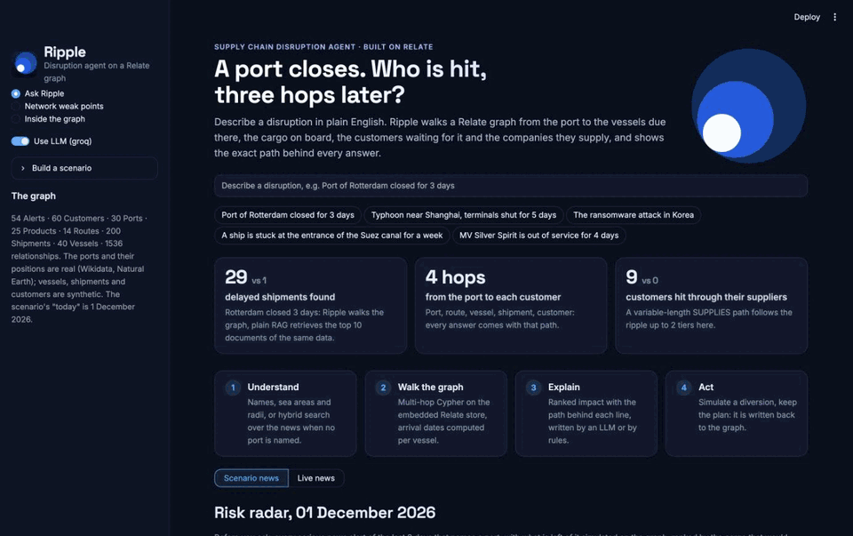
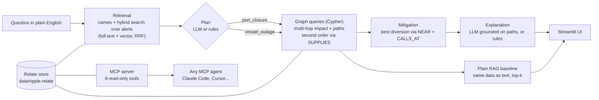
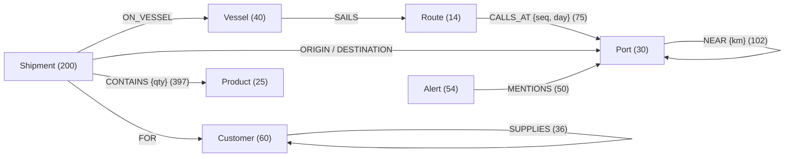

# Ripple

[](https://github.com/tballochi/ripple-supply-chain-agent/actions/workflows/tests.yml)

**Describe a supply chain disruption in plain English. Ripple walks a [Relate](https://relatedb.ai)
graph of ports, vessels, shipments and customers, finds everyone affected several hops away,
shows the exact path behind each answer, and simulates the best diversion.**



**Live demo:** _coming soon (Streamlit Community Cloud)_ · Built for the Relate by Neo4j Hackathon ·
All data is synthetic.

## Why a graph

"Port of Rotterdam closed for 3 days." The shipments that will be late are not the ones whose
documents mention Rotterdam. They are the ones on **vessels** sailing **routes** that call at
Rotterdam **during those 3 days**, still carrying cargo to Rotterdam **or a later port**. Then come
the **customers** waiting for that cargo, and the **buyers supplied by those customers**. That is a
4 to 6 hop question.

Ripple answers the same question both ways, on the same data, in the **Graph vs plain RAG** tab.
Plain RAG gets every record (shipments, vessels, routes, customers, ports, news) as a text
document and the same hybrid word + meaning search, and retrieves the top 10:

| Question | | Delayed shipments | Affected customers | Second-order customers | Explained by a path |
|---|---|---:|---:|---:|---:|
| Port of Rotterdam closed for 3 days | **Ripple** | **29** | **26** | **6** | **29** |
| | plain RAG | 1 | 3 | 0 | 0 |
| The ransomware attack in Korea | **Ripple** | **13** | **12** | **5** | **13** |
| | plain RAG | 0 | 0 | 0 | 0 |
| Typhoon near Shanghai, terminals shut for 5 days | **Ripple** | **17** | **15** | **6** | **17** |
| | plain RAG | 1 | 2 | 0 | 0 |
| MV Silver Spirit is out of service for 4 days | **Ripple** | **5** | **5** | **3** | **5** |
| | plain RAG | 5 | 5 | 0 | 0 |

The last row is the honest control: a vessel's shipments are one hop away, so plain RAG finds
them too. It still cannot reach the second-order customers or explain why. Run it yourself:
`python -m ripple.plain_rag "Port of Rotterdam closed for 3 days"`.

## What it does

1. **Understands the question.** Hybrid retrieval (full-text + vector in Relate) matches the text
   to ports, vessels, countries, or a news alert, then follows `(Alert)-[:MENTIONS]->(Port)`.
   "The ransomware attack in Korea" names no port; the alert does.
2. **Walks the graph.** A Cypher query goes `Port <- Route <- Vessel <- Shipment -> Customer`,
   checks the dates and the order of port calls, and tells cargo **on board** from cargo
   **not loaded yet**. One more hop, `-[:SUPPLIES]->`, finds second-order customers.
3. **Ranks and explains.** Score = days late × priority × customer tier, doubled beyond the
   customer's tolerance. Every line comes with its path, e.g.
   `Rotterdam <-[CALLS_AT]- North Europe Feeder <-[SAILS]- MV Northern Breeze <-[ON_VESSEL]- S0138 -[FOR]-> Tessera Retail`.
4. **Simulates a mitigation.** Pick a nearby port (`NEAR`) and see before/after: Rotterdam →
   Hamburg rescues 13 shipments, avoids 8 of 14 tolerance breaches and protects $2.9M of cargo.
5. **Works with or without an LLM.** With a free Groq or Mistral key, the LLM picks the query and
   writes the explanation from the returned paths only (a shipment it invents is rejected).
   Without a key, a deterministic rule-based mode gives the same analysis.
6. **Serves any agent over MCP.** The graph is exposed as 8 read-only tools.

## Architecture



## Graph model

423 nodes, 1,500 relationships, generated by `ripple/generate.py` with a fixed seed.



## Setup (5 commands)

```bash
git clone https://github.com/tballochi/ripple-supply-chain-agent.git && cd ripple-supply-chain-agent
python3 -m venv .venv && source .venv/bin/activate      # Python 3.12 or 3.13
pip install -r requirements.txt
python -m ripple.embeddings --download                  # optional: ~70 MB model for search by meaning
streamlit run app.py
```

No database to start and no key needed: the Relate store is committed in `data/ripple.relate`.
For the LLM mode, `cp .env.example .env` and add a free Groq or Mistral key.
To rebuild the data: `python -m ripple.generate`. To run the 95 tests: `python -m pytest`.

## Example questions

- `Port of Rotterdam closed for 3 days`
- `Typhoon near Shanghai, terminals shut for 5 days`
- `The ransomware attack in Korea` (no port named: found through a news alert)
- `A ship is stuck at the entrance of the Suez canal for a week`
- `MV Silver Spirit is out of service for 4 days`
- `Strike in the Netherlands` or `ports in China closed for 2 days` (country matching)

The same analysis from the terminal:

```bash
python -m ripple.agent "Port of Rotterdam closed for 3 days"
python -m ripple.mitigation Rotterdam Hamburg 3
python -m ripple.plain_rag "The ransomware attack in Korea"
```

## How Relate is used

| Relate feature | Where |
|---|---|
| Embedded store, directory layout with the readable JSON codec, opened read-only by the app | `ripple/db.py`, `data/ripple.relate` |
| Uniqueness constraints (one per label, backing the key lookups) | `ripple/db.py` |
| Batch loading with `UNWIND $rows ... CREATE` | `ripple/generate.py` |
| Typed vectors: `vector(r.vector, 384, FLOAT32)` | `ripple/generate.py` |
| `CREATE VECTOR INDEX` and `CREATE FULLTEXT INDEX` on alerts | `ripple/db.py` |
| `SEARCH ... IN (VECTOR INDEX / FULLTEXT INDEX ...) SCORE AS`, fused by reciprocal rank in `CALL () { ... UNION ALL ... }` | `ripple/retrieval.py` |
| Multi-hop pattern with a path variable, `nodes(p)`, `relationships(p)`, `startNode()` to return the explanation | `ripple/queries.py` |
| Date arithmetic: `v.voyage_start + duration({days: call.day})`, `duration.inDays()` | `ripple/queries.py` |
| `COLLECT { ... }` and `EXISTS { ... }` subqueries | `ripple/queries.py`, `ripple/plain_rag.py`, `ripple/mitigation.py` |
| `CALL db.schema.nodeTypeProperties()` for the agent's schema tool | `ripple/mcp_server.py` |

### MCP

Register the server in any MCP client (a `.mcp.json` is included for Claude Code):

```json
{ "mcpServers": { "ripple": { "command": ".venv/bin/python", "args": ["-m", "ripple.mcp_server"] } } }
```

Tools: `analyze_disruption`, `port_closure_impact`, `vessel_outage_impact`, `simulate_diversion`,
`compare_with_plain_rag`, `search_alerts`, `get_schema`, `read_cypher`. All are read-only.
Relate also ships its own generic MCP server with the `relate` CLI
(`relate serve --mcp stdio --database data/ripple.relate --read-only`); Ripple's server adds the
domain tools on top.

## Project layout

```
ripple/generate.py     synthetic data + load into Relate
ripple/queries.py      multi-hop impact queries, paths, ranking
ripple/retrieval.py    free text -> ports / vessels (names + hybrid alert search)
ripple/mitigation.py   diversion simulator
ripple/plain_rag.py    plain RAG baseline for the comparison
ripple/agent.py        understand -> query -> explain, LLM or rules
ripple/mcp_server.py   MCP tools
app.py                 Streamlit UI
tests/                 95 tests, run in CI on every push
```

## Limitations and next steps

- **Synthetic data.** Real port names and coordinates, invented everything else. The scenario's
  "today" is fixed at 1 December 2026 so every run gives the same answers.
- **A deliberately simple delay model.** A vessel waits until the port reopens; no berth queues,
  no capacity, no knock-on congestion after reopening. Diversions use fixed speeds (800 km/day at
  sea, 500 km/day by road or feeder, transfers up to 600 km).
- **One disruption at a time**, starting on the scenario date.
- **Next:** live AIS vessel positions, several overlapping disruptions, inventory buffers at
  customers, and writing the chosen mitigation back to the graph as a plan.

## AI tools used

- **The code, tests and documentation were written with [Claude Code](https://claude.com/claude-code)**
  (Anthropic), working under my direction milestone by milestone. I reviewed and can explain
  every part.
- **At runtime, optionally:** an LLM through the free tier of Groq (`openai/gpt-oss-120b`) or
  Mistral (`mistral-small-latest`) for planning and explanations.
- **Embeddings:** `BAAI/bge-small-en-v1.5`, run locally with fastembed.

## License

MIT, see [LICENSE](LICENSE).
