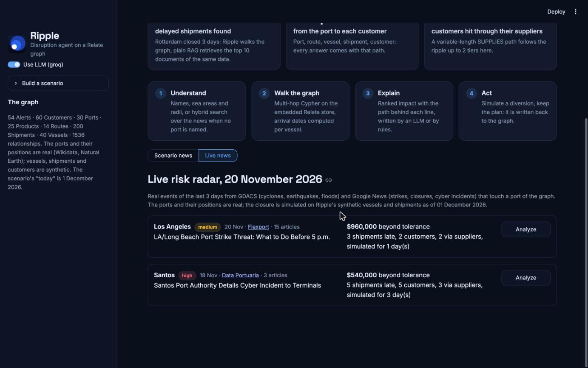
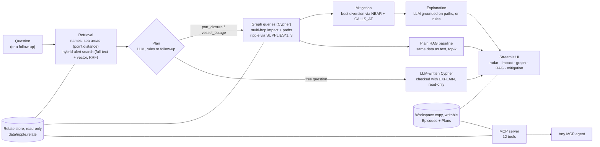
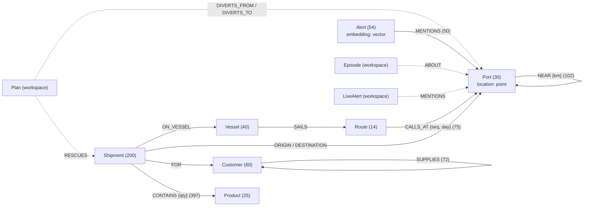

<p align="center"></p>

<h1 align="center">Ripple</h1>

<p align="center"><b>When a port closes, who is hurt three hops away?</b><br>
A supply chain disruption agent on a <a href="https://relatedb.ai">Relate</a> graph.</p>

<p align="center">
<a href="https://github.com/tballochi/ripple-supply-chain-agent/actions/workflows/tests.yml"></a>
· <b>Live demo:</b> <i>coming soon</i> · <b>Video:</b> <i>coming soon</i> · Relate by Neo4j Hackathon
</p>


## In 30 seconds

- **Ask in plain English**: "Port of Rotterdam closed for 3 days", "the ransomware attack in Korea",
  "typhoon in the South China Sea", then follow up: "and if it lasts a week?".
- **Ripple walks the graph**: port → routes → vessels due during the closure → cargo on board or not
  loaded yet → customers → the companies they supply, up to 3 supplier tiers. Every answer comes
  with **the exact path** that explains it.
- **It finds 29 delayed shipments where plain RAG finds 1**, on the same data and the same question.
- **It acts**: a risk radar ranks today's news by exposure before you ask, a simulator finds the
  best diversion (Rotterdam → Hamburg protects $2.9M), and kept plans are written back to the graph.
- **It runs anywhere**: 5 commands, no database server, no API key needed (an LLM is optional),
  and every capability is also an **MCP server** for other agents.
- **It reads the real news**: switch the radar to **Live news** and today's real events (GDACS
  hazards, Google News headlines on strikes, closures and cyber incidents) are matched to the ports
  of the graph and simulated on it. The ports and their positions are real (Wikidata, Natural
  Earth); vessels, shipments and customers are synthetic.

## Why a graph

"Port of Rotterdam closed for 3 days." The late shipments are not the ones whose documents mention
Rotterdam. They are the ones on **vessels** sailing **routes** that call at Rotterdam **during those
3 days**, still carrying cargo to Rotterdam **or a later port**. Then come the **customers** waiting
for that cargo, and the **companies they supply**. That is a 4 to 7 hop question.

Ripple answers each question both ways, in the **Graph vs plain RAG** tab. Plain RAG gets every
record (shipments, vessels, routes, customers, ports, news) as a text document and the same hybrid
word + meaning search, and retrieves the top 10:

| Question | | Delayed shipments | Affected customers | Customers via suppliers | Explained by a path |
|---|---|---:|---:|---:|---:|
| Port of Rotterdam closed for 3 days | **Ripple** | **29** | **26** | **9** | **29** |
| | plain RAG | 1 | 3 | 0 | 0 |
| The ransomware attack in Korea | **Ripple** | **13** | **12** | **9** | **13** |
| | plain RAG | 0 | 0 | 0 | 0 |
| Typhoon near Shanghai, terminals shut for 5 days | **Ripple** | **17** | **15** | **10** | **17** |
| | plain RAG | 1 | 1 | 0 | 0 |
| Storm in the North Sea for 2 days (5 ports) | **Ripple** | **34** | **29** | **7** | **34** |
| | plain RAG | 0 | 0 | 0 | 0 |
| MV Silver Spirit is out of service for 4 days | **Ripple** | **5** | **5** | **8** | **5** |
| | plain RAG | 5 | 5 | 0 | 0 |

The last row is the honest control: a vessel's shipments are one hop away, so plain RAG finds them
too. It still cannot reach the companies those customers supply, or explain why.
Reproduce it: `python -m ripple.plain_rag "Port of Rotterdam closed for 3 days"`.

**Retrieval is measured too.** `python -m ripple.evaluate` runs 33 questions with known answers:

| Set-up | Port or vessel named | Country, sea area, radius | News incident, no port named | Pasted headline | Off-topic (must find nothing) | **All** |
|---|---:|---:|---:|---:|---:|---:|
| names only | 5/5 | 5/5 | 3/12 | 0/5 | 6/6 | **58%** |
| + full-text index | 5/5 | 5/5 | 9/12 | 5/5 | 6/6 | **91%** |
| + vector index | 5/5 | 5/5 | 12/12 | 5/5 | 6/6 | **100%** |
| hybrid (Ripple) | 5/5 | 5/5 | 12/12 | 5/5 | 6/6 | **100%** |

The vector index finds incidents described without any port name; the full-text index keeps Ripple
above 90% when the embedding model is unavailable (checked in CI).

## Setup (5 commands)

```bash
git clone https://github.com/tballochi/ripple-supply-chain-agent.git && cd ripple-supply-chain-agent
python3 -m venv .venv && source .venv/bin/activate      # Python 3.12 or 3.13
pip install -r requirements.txt
python -m ripple.embeddings --download                  # optional: ~70 MB model for search by meaning
streamlit run app.py
```

The Relate store is committed in `data/ripple.relate`: nothing to start or load. For the LLM mode,
`cp .env.example .env` and add a free Groq key. Tests: `python -m pytest` (167 tests, run in CI on
Python 3.12 and 3.13 with a lint step and a check that the committed store matches the generator).

## Try these

| Question | Shows |
|---|---|
| `Port of Rotterdam closed for 3 days` | 4-hop impact, on board vs not loaded yet, ripple through suppliers, best diversion |
| then `and if it lasts a week?`, `what about Antwerp instead?`, `and Hamburg too?` | follow-ups that reuse, replace or extend the scenario |
| `The ransomware attack in Korea` | no port named: hybrid search finds the news alert, `MENTIONS` leads to Busan |
| `Typhoon in the South China Sea`, `storm within 500 km of Singapore` | geography with Relate point values |
| `Hurricane in the Gulf of Mexico` | no port of the graph there: Ripple says so and names the closest |
| `MV Silver Spirit is out of service for 4 days` | a vessel outage |
| `Which customers buy sneakers?` (LLM mode) | a free question answered with checked, read-only Cypher |

Or open the app with no question: the **risk radar** lists today's alerts by exposure, each with an
**Analyze** button. Switch it to **Live news** for today's real events (needs internet; free
sources, no key): `python -m ripple.live` does the same in the terminal.



## What it does

1. **Understands the question.** Port, vessel and country names; sea areas and radii with
   `point.distance()`; news incidents with hybrid retrieval (Relate's full-text and vector indexes,
   fused by reciprocal rank), then `(Alert)-[:MENTIONS]->(Port)`. Follow-ups reuse the last plan.
2. **Walks the graph.** One Cypher query goes `Port <- Route <- Vessel <- Shipment -> Customer`,
   computes each vessel's arrival from its voyage start and the route's port calls, and keeps the
   cargo still to be delivered there or later. A variable-length path `-[:SUPPLIES*1..3]->`
   follows the ripple. Several ports at once are combined, each shipment counted once.
3. **Ranks and explains.** Score = days late × priority × customer tier, doubled beyond the
   customer's tolerance. With an LLM (Groq free tier), the model picks one of two fixed queries and
   writes the explanation from the returned paths only; an invented shipment gets the text rejected.
   Without a key, a deterministic rule-based mode gives the same analysis.
4. **Acts.** The diversion simulator uses `NEAR` and shared routes (`CALLS_AT`) to compute
   before/after delays, breaches avoided and extra distance. The risk radar runs that analysis on
   every serious alert of the last 3 days, from the scenario's news or from today's real news
   (`ripple/live.py`: GDACS orange and red hazards within a radius of a port found with
   `point.distance()`, and headlines that name a port).
5. **Remembers.** Analyses become `(:Episode)-[:ABOUT]->(:Port)` and kept diversions become
   `(:Plan)-[:RESCUES]->(:Shipment)` in a writable copy of the graph, so the agent recalls earlier
   analyses and the decision log shows the customers each plan protects.

## Architecture



## Graph model

423 nodes and 1,536 relationships, generated by `ripple/generate.py` with a fixed seed. The
workspace copy adds the agent's `Episode` and `Plan` nodes and the real news as `LiveAlert` nodes.
Port positions come from `data/ports.csv`, where each port is pinned to a Wikidata item or a
Natural Earth record (`python -m ripple.ports_source` rebuilds it).



## How Relate is used

| Relate feature | Where |
|---|---|
| Embedded store, directory layout with the readable JSON codec, opened read-only by the app | `ripple/db.py`, `data/ripple.relate` |
| A second, writable copy for memory and decisions, read while another session writes | `ripple/workspace.py` |
| Multi-hop pattern with a path variable, `nodes(p)`, `relationships(p)`, `startNode()` to return the explanation | `ripple/queries.py` |
| Variable-length path `-[:SUPPLIES*1..3]->` with `length(p)` | `ripple/queries.py` |
| `CREATE VECTOR INDEX`, `CREATE FULLTEXT INDEX`, `SEARCH ... SCORE AS`, fused in `CALL () { ... UNION ALL ... }` | `ripple/db.py`, `ripple/retrieval.py` |
| Typed vectors `vector(r.vector, 384, FLOAT32)` | `ripple/generate.py` |
| Spatial values `point({latitude, longitude})`, `CREATE POINT INDEX`, `point.distance()` | `ripple/generate.py`, `ripple/retrieval.py` |
| Date arithmetic `v.voyage_start + duration({days: call.day})`, `duration.inDays()` | `ripple/queries.py` |
| `COLLECT { }` and `EXISTS { }` subqueries, `FOREACH`, `UNWIND $rows ... CREATE` | across `ripple/` |
| `EXPLAIN` to check LLM-written Cypher (syntax and read-only query type) before it runs | `ripple/lookup.py` |
| `CALL db.schema.nodeTypeProperties()` for the schema given to the LLM and to MCP agents | `ripple/lookup.py`, `ripple/mcp_server.py` |
| Uniqueness constraints on every key | `ripple/db.py` |

<details>
<summary><b>MCP server: 12 tools</b></summary>

Register it in any MCP client (a `.mcp.json` is included for Claude Code):

```json
{ "mcpServers": { "ripple": { "command": ".venv/bin/python", "args": ["-m", "ripple.mcp_server"] } } }
```

`analyze_disruption`, `port_closure_impact`, `vessel_outage_impact`, `simulate_diversion`,
`compare_with_plain_rag`, `risk_radar`, `live_radar`, `recall_analyses`, `list_plans`, `search_alerts`,
`get_schema`, `read_cypher`. Each impacted shipment comes with its `path`, so the calling agent can
explain its answer too.

Relate's own MCP server also serves the same store, read-only (`read_cypher` with a `statement`
argument, and `get_schema`; writes are refused). It needs the
[`relate` CLI](https://relatedb.ai/docs/get-started/install/):

```json
{ "mcpServers": { "relate": { "command": "relate",
  "args": ["serve", "--mcp", "stdio", "--database", "data/ripple.relate", "--read-only"] } } }
```
</details>

<details>
<summary><b>Explore the graph yourself with the Relate CLI</b></summary>

The committed store opens with Relate's CLI too (tested with v1.1.0, read-only, so it stays
unchanged):

```bash
relate --database data/ripple.relate --read-only --mode table \
  "MATCH (p:Port {name: 'Rotterdam'})<-[:CALLS_AT]-(r:Route)<-[:SAILS]-(v:Vessel)
   RETURN r.name AS route, count(v) AS vessels ORDER BY vessels DESC"
relate query --database data/ripple.relate --read-only     # interactive shell
```
</details>

<details>
<summary><b>Command line</b></summary>

```bash
python -m ripple.agent "Port of Rotterdam closed for 3 days"   # full answer (add --no-llm)
python -m ripple.radar                                         # today's alerts by exposure
python -m ripple.mitigation Rotterdam Hamburg 3                # one diversion, before/after
python -m ripple.plain_rag "The ransomware attack in Korea"    # graph vs plain RAG
python -m ripple.evaluate                                      # retrieval scores
python -m ripple.lookup "which customers buy sneakers?"        # free question (LLM key needed)
python -m ripple.generate                                      # rebuild the data
```
</details>

<details>
<summary><b>Project layout</b></summary>

```
ripple/generate.py     synthetic data + load into Relate
ripple/queries.py      multi-hop impact queries, paths, ranking, combined disruptions
ripple/retrieval.py    free text -> ports / vessels (names, geography, hybrid alert search)
ripple/agent.py        understand -> query -> explain, LLM or rules, follow-ups, memory
ripple/mitigation.py   diversion simulator
ripple/radar.py        risk radar of today's alerts
ripple/live.py         real news (GDACS, Google News) matched to ports, stored as LiveAlerts
ripple/ports_source.py real port positions from Wikidata and Natural Earth -> data/ports.csv
ripple/workspace.py    writable copy of the graph: Episodes and Plans
ripple/lookup.py       free questions: LLM-written, checked, read-only Cypher
ripple/plain_rag.py    plain RAG baseline for the comparison
ripple/evaluate.py     retrieval scores on 33 questions
ripple/viz.py          static and interactive graph drawings
ripple/mcp_server.py   MCP tools
app.py                 Streamlit UI
tests/                 167 tests
```
</details>

## Limitations and next steps

- **Synthetic network, real ports and news.** Port positions come from open data and the live
  radar reads real events, but routes, vessels, shipments and customers are invented: no public
  source says whose cargo is on which ship. Real events are simulated on the network as it stands
  on its fixed "today", 1 December 2026, so every run gives the same answers to the same news.
- **Live news matching is simple.** A headline counts when it names a port of the graph (or a
  known alias such as Long Beach for Los Angeles) and a disruption word; "looms", "could" or
  "talks" make it a threat (medium, 1 day by default). Google News RSS is a free public feed with
  no service guarantee; when a source fails, the news fetched earlier is used.
- **A deliberately simple delay model.** A vessel waits until the port reopens; no berth queues or
  knock-on congestion. Diversions use fixed speeds (800 km/day at sea, 500 km/day by road or feeder,
  transfers up to 600 km). Several disruptions are combined with each shipment's largest delay.
- **Current voyages only.** A closure starting after early December finds fewer vessels scheduled.
- **The workspace is local.** Plans and memory live in `.ripple/` on the machine running the app
  (on a hosted demo, until it restarts).
- **Next:** live vessel positions (AIS), inventory buffers at customers, and plans that update the
  vessels' schedules.

## AI tools used

- **The code, tests and documentation were written with [Claude Code](https://claude.com/claude-code)**
  (Anthropic), working under my direction milestone by milestone.
- **At runtime, optionally:** an LLM through the free tier of Groq (`openai/gpt-oss-120b`), or
  Mistral (`mistral-small-latest`), for planning, explanations and free questions.
- **Embeddings:** `BAAI/bge-small-en-v1.5`, run locally with fastembed.

## License

MIT, see [LICENSE](LICENSE).
